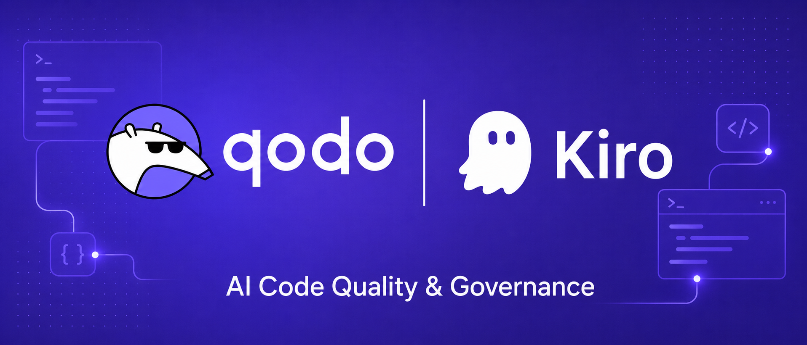

  

# Qodo for NeuralBridge

Generated skills contain the complete reviewed Qodo playbooks for this release.
Install or update Qodo from the **Powers** panel in NeuralBridge IDE.
The Qodo CLI remains a separate runtime and is never bundled here.

## Optional read-only permission

The stable `qodo read ...` gateway exposes only tools that the live Qodo catalog
explicitly marks non-mutating. To remove repeated safe-read prompts, choose **Always allow**
for the exact `qodo read *` pattern in NeuralBridge, or review and merge
`qodo-read-only.permissions.yaml` into your user- or workspace-scoped NeuralBridge permissions.
Keep every other Qodo command on ask. The Power never changes permission files itself.

- Privacy: https://www.qodo.ai/privacy-policy/
- Support: https://help.qodo.ai/hc/en-us/requests/new
- Terms: https://www.qodo.ai/terms/
